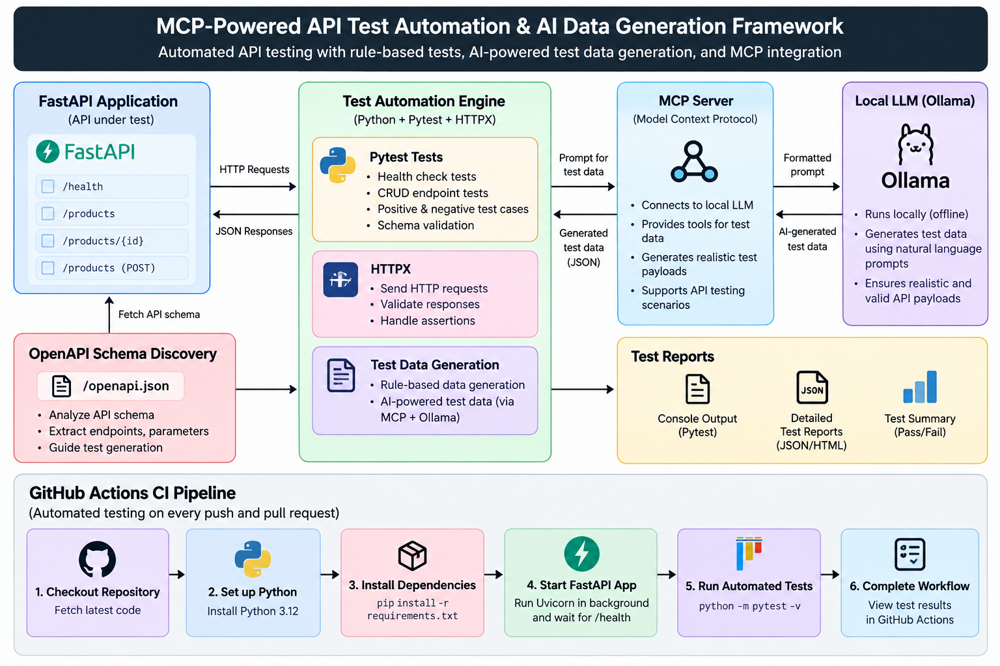

# MCP-Powered API Test Automation & AI Data Generation Framework
[](https://github.com/adriijaaaa/mcp-api-test-automation/actions/workflows/tests.yml)
An API testing framework combining rule-based testing, local AI-assisted test generation, boundary-value analysis, and Model Context Protocol (MCP) tools.

## Features

- API endpoint discovery using OpenAPI
- Rule-based positive and negative test generation
- AI-assisted test generation using Ollama
- Boundary-value and invalid-type testing
- HTTP response and validation checks
- MCP tools for test generation and execution
- Consolidated JSON test reporting

## Technology Stack

- Python
- FastAPI
- OpenAPI
- Ollama with qwen2.5:3b
- Model Context Protocol (MCP)
- Requests, HTTPX, and JSON

## Latest Test Results

| Test suite | Total | Passed | Failed |
|---|---:|---:|---:|
| Rule-based | 5 | 5 | 0 |
| AI-assisted | 3 | 3 | 0 |
| Boundary-value | 14 | 14 | 0 |
| **Total** | **22** | **22** | **0** |

These results reflect the latest saved test reports and may change when the tests are rerun.

## Setup

Create and activate a virtual environment on Windows:

```powershell
python -m venv .venv
.\.venv\Scripts\Activate.ps1
```

Install dependencies:

```powershell
python -m pip install -r requirements.txt
```

## Start the API

```powershell
python -m uvicorn app.main:app --reload
```

Open the interactive API documentation at http://127.0.0.1:8000/docs.

## Run the Test Suites

Keep the API running. Execute these commands from the project root:

```powershell
python -m api.openapi_parser
python -m api.test_generator
python -m api.test_runner
python -m api.ai_test_generator
python -m api.run_ai_tests
python -m api.boundary_test_runner
python -m api.consolidated_report
```

Ollama must be running with the qwen2.5:3b model available for AI-assisted generation.

## MCP Integration

Run the MCP integration client:

```powershell
python -m mcp_server.test_connection
```

The server exposes tools for API discovery, rule-based testing, AI-assisted testing, boundary testing, and consolidated reporting.

## Project Structure

```text
app/          Sample FastAPI application
api/          Test generation, execution, and reporting
mcp_server/   MCP server and integration client
test_data/    Generated test cases
reports/      Test execution reports
tests/        Additional tests
```

## Future Improvements

- Add CI/CD integration
- Expand API coverage
- Improve test reporting and failure diagnostics
- Add more configurable test scenarios

## Architecture

The framework combines OpenAPI-based endpoint discovery, rule-based API testing, AI-assisted test data generation using local Ollama, MCP tool integration, and consolidated test reporting.



## Test Results

The framework has been validated using automated API tests and standalone test-generation workflows.

| Test Suite | Result |
|---|---:|
| Pytest automated tests | 10/10 passed |
| Rule-based test suite | 5/5 passed |
| AI-generated test suite | 3/3 passed |
| Boundary test suite | 14/14 passed |
| **Standalone test workflows** | **22/22 passed** |

The pytest suite runs in GitHub Actions on pushes and pull requests. The standalone results are from separate local test runs.